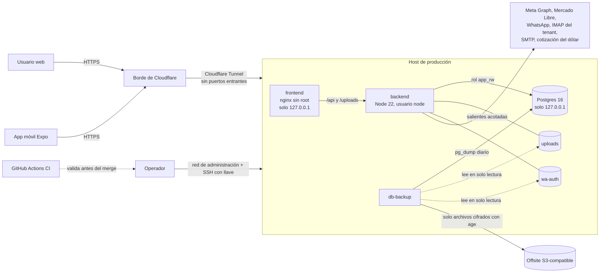

# Arquitectura de AUTENZA

Vista de una página para quien llega al código o lo audita. Los nombres de
archivo son reales; los valores de infraestructura (hosts, usuarios, IPs) no van
en este repo.

## Componentes



- **Entrada pública:** solo por Cloudflare Tunnel. El host no abre puertos
  entrantes a internet. nginx y Postgres escuchan en loopback; el backend no
  publica puertos (`docker-compose.yml`).
- **Contenedores:** `no-new-privileges`, `cap_drop: ALL`, procesos sin root
  (`BackConcesionaria/Dockerfile`, imagen `nginx-unprivileged` en el front).
- **Administración:** por una red privada de administración y SSH con llave.
  Prisma Studio solo arranca con el perfil `debug`.

## Backend: capas (hexagonal)

| Capa | Carpeta | Regla |
|---|---|---|
| Dominio | `src/domain/` | Entidades y reglas puras (`services/stateMachine.ts`, `services/pagoCuota.ts`). No conoce Express ni Prisma. |
| Aplicación | `src/application/use-cases/`, `src/application/services/` | Un caso de uso por operación de negocio. Orquesta repositorios y transacciones. |
| Infraestructura | `src/infrastructure/` | Prisma y repositorios, seguridad, email, integraciones, workers, storage. |
| Interfaz | `src/interface/` | Rutas, controllers, middlewares y schemas Zod. Acá vive el concepto de rol. |

Flujo de un request: `requestLogger` → `context` (usuario, tenant, IP en
`AsyncLocalStorage`, `src/infrastructure/security/context.ts`) → `authenticate`
(global en `src/routes/index.ts`) → `authorize(...)` por ruta → `validateBody`
(Zod descarta claves desconocidas) → controller → caso de uso → repositorio.

## Multi-tenant: tres capas

1. **Extensión de Prisma** (`src/infrastructure/database/prisma.extension.ts`):
   inyecta `concesionariaId` en lecturas, altas, updates y borrados; reescribe
   los borrados como soft-delete; y abre cada operación en una transacción que
   setea las variables de sesión `app.tenant_id` y `app.is_super_admin`.
2. **RLS de Postgres** (`prisma/init-rls.ts`): `ENABLE` + `FORCE ROW LEVEL
   SECURITY` y una policy `tenant_iso` con `USING` y `WITH CHECK` en cada tabla
   de `TENANT_TABLES`.
3. **Rol de runtime sin privilegios** (`prisma/setup-app-role.ts`): el servidor
   se conecta como `app_rw` (`NOSUPERUSER NOBYPASSRLS`), así la RLS filtra de
   verdad. La conexión de superusuario solo la usan `migrate deploy`,
   `init-rls` y `setup-app-role` en el arranque; el proceso del servidor arranca
   con `exec env DATABASE_URL=<app_rw>` y no la hereda. En producción el
   arranque falla si falta `APP_DATABASE_URL` (`src/config/env.ts`).

Caminos que no pasan por la extensión (`rawPrisma`, `$queryRaw`):
`withTenantTransaction` para operaciones de negocio y `withAuthBypass` solo para
credenciales y plataforma (`src/infrastructure/database/unitOfWork.ts`). Bajo
`app_rw`, un camino sin tenant ve cero filas sin error: hay que probarlo con el
job `integration-rls` del CI.

`super_admin` es la cuenta de plataforma: la extensión no le inyecta tenant y la
RLS lo deja pasar. Sus escrituras quedan en `security_events`
(`src/infrastructure/security/audit.ts`).

## Autenticación

```mermaid
sequenceDiagram
    participant W as Web
    participant A as API
    W->>A: POST /api/auth/login (email, contraseña) + X-Autenza-Cliente: web
    A-->>W: si el 2FA aplica: token intermedio (5 min, propósito MFA)
    W->>A: POST /api/auth/login/2fa (código TOTP o de recuperación)
    A-->>W: access JWT (15 min, en memoria) en el cuerpo; refresh (7 días) SÓLO en la cookie autenza_rt
    Note over W,A: cookie httpOnly, SameSite=Strict, Path=/api/auth, Secure en producción
    W->>A: POST /api/auth/refresh (cookie)
    A-->>W: access nuevo; la cookie rota y el refresh anterior queda consumido
    Note over W,A: a los SESION_MAX_DIAS (30) del login: 401 SESION_MAXIMA_VENCIDA
```

- Contraseñas con bcrypt; política de 10+ caracteres y lista de contraseñas
  comunes (`src/interface/validation/password.ts`).
- Login con señuelo de tiempo y rate limit por IP+cuenta y por cuenta
  (`src/interface/middlewares/rateLimiters.ts`).
- JWT HS256 fijado (`src/infrastructure/security/jwtOptions.ts`).
- Refresh guardado hasheado, rotación atómica y detección de reuso: si se usa uno
  ya consumido se revocan todas las sesiones del usuario
  (`src/application/use-cases/auth/RefreshAuth.ts`).
- Vencimiento absoluto: cada refresh guarda su sesión (`familia`) y cuándo fue el
  login; las rotaciones lo heredan y, pasados `SESION_MAX_DIAS` (30 por defecto),
  la sesión se corta con `SESION_MAXIMA_VENCIDA` y queda un `sesion_vencida` en
  `security_events` (`src/application/use-cases/auth/vigenciaSesion.ts`).
- La web se identifica con `X-Autenza-Cliente: web` y no recibe el refresh en
  ningún cuerpo; un refresh renovado con la cookie tampoco vuelve en el JSON. La
  app móvil (sin la cabecera, con `body.refreshToken`) mantiene su contrato. El
  access token lleva `sid` (la sesión) para que Ajustes conserve la sesión del
  navegador al cambiar la contraseña sin tener el refresh
  (`src/application/use-cases/auth/ConservarSesionActual.ts`).
- 2FA TOTP con anti-replay y códigos de recuperación de un solo uso
  (`src/application/services/mfaService.ts`, `src/infrastructure/security/totp.ts`).
  Qué roles lo deben tener lo define `MFA_REQUIRED_ROLES`
  (`src/infrastructure/security/mfaPolicy.ts`). Una sesión con el 2FA pendiente
  solo puede configurarlo.
- App móvil: los tokens van en `expo-secure-store` (Keychain / Keystore).

## Archivos subidos

`/uploads` tiene dos zonas (`src/interface/middlewares/uploads.middleware.ts`):
pública (fotos de unidades) y privada (legajos de financiación), que se sirve
solo con URL firmada con vencimiento (`src/infrastructure/security/urlFirmada.ts`)
y `Cache-Control: private, no-store`. Al subir se valida el contenido real del
archivo, no la extensión ni el MIME declarado
(`src/infrastructure/security/contenidoArchivo.ts`).

## Workers (en el mismo proceso, `src/server.ts`)

| Worker | Archivo | Qué hace |
|---|---|---|
| Ingesta de emails | `src/infrastructure/integraciones/emailIngest.ts` | Lee la casilla IMAP configurada por el tenant y crea consultas. |
| Cierre diario de atenciones | `src/infrastructure/atencion/cierreDiarioWorker.ts` | Cierra las atenciones abiertas pasada la hora de corte. |
| Envío de WhatsApp | `src/infrastructure/whatsapp/envioWorker.ts` | Despacha la cola de salida con espaciado entre mensajes. |
| Sincronización de Mercado Libre | `src/infrastructure/mercadolibre/meliSyncWorker.ts` | Levanta preguntas perdidas y reconcilia publicaciones. |
| Cuentas de WhatsApp | `src/application/services/whatsappManager.ts` | Reconecta las sesiones vinculadas al arrancar. |

No hay Redis ni colas externas. Los workers son cross-tenant y no tienen
request: usan `withAuthBypass` o fijan el tenant explícito.

## Integraciones

| Integración | Archivos | Control principal |
|---|---|---|
| Meta (Lead Ads, Messenger, Instagram) | `src/infrastructure/integraciones/meta*.ts` | Webhook con HMAC-SHA256 sobre el body crudo; salientes solo hacia la API de Meta. |
| Mercado Libre | `src/infrastructure/mercadolibre/meliClient.ts`, `src/application/services/meli*.ts` | OAuth con `state` atado al navegador; tokens cifrados; vincular exige la clave de cifrado. |
| WhatsApp | `src/infrastructure/whatsapp/whatsappClient.ts` | Cliente no oficial (Baileys); sesiones en el volumen `wa-auth`. |
| Casillas IMAP | `src/infrastructure/integraciones/emailIngest.ts` | Destino validado contra redes privadas y puertos 143/993 (`src/infrastructure/security/destinoSeguro.ts`). |
| Cotización del dólar | `src/infrastructure/cotizacion/dolarBlue.ts` | Solo lectura desde el servidor; si falla, no convierte. |
| AFIP | `src/infrastructure/afip/` | Hoy solo modo simulado (CAE de prueba, rotulado sin validez fiscal). |

Los secretos de integraciones, los tokens de Mercado Libre y los secretos TOTP se
guardan cifrados con AES-256-GCM (`src/infrastructure/security/secretBox.ts`) usando
`INTEGRACIONES_SECRET_KEY`, atados a su fila con AAD y con el identificador de la
clave para poder rotarla (`INTEGRACIONES_SECRET_KEYS_ANTERIORES` +
`npm run recifrar-secretos`; ver [criptografía y secretos](../seguridad/criptografia-y-secretos.md)).

## Registro

- `audit_log`: acciones de negocio por tenant. `security_events`: lo que no tiene
  tenant (super_admin, fuerza bruta, escapes de emergencia). Ambas son
  append-only para `app_rw` (`prisma/setup-app-role.ts`).
- Logs JSON a stdout con redacción de credenciales en la query
  (`src/interface/middlewares/requestLogger.middleware.ts`); Docker rota por
  tamaño. Ver [registros y monitoreo](../seguridad/registros-y-monitoreo.md).

## CI

`.github/workflows/ci.yml`: build y unitarios; integración contra Postgres
descartable con `migrate deploy` y drift guard; la misma suite con el backend
como `app_rw`; verificación de RLS; lógica de backups; build del front. Las
Actions van fijadas por SHA y el token tiene `contents: read`. Ver
[gestión de cambios](../seguridad/gestion-de-cambios.md) para los checks
obligatorios.
